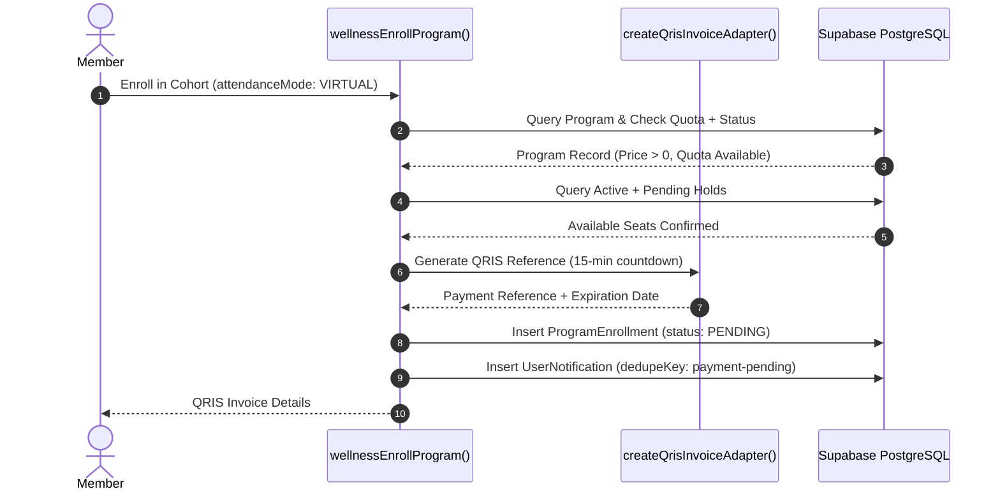

# API & BACKEND FLOW AUDIT

**Project:** `wellness-pwa` (+ BMS — Longevity & Movement Sanctuary)  
**Architecture:** Next.js Route Handlers (REST) + Next.js Server Actions (RPC)  
**Security & Reliability Rating:** **82 / 100**  
**Audit Scope:** HTTP Endpoints, Server Actions, Error Contracts, Input Schemas, Idempotency  

---

## 1. REST API Route Handlers Audit (`/api/*`)

| Endpoint | Method | Auth Guard | Input Validation | Status Codes | Rate Limit | Vulnerability / Reliability Findings |
| :--- | :--- | :--- | :--- | :--- | :--- | :--- |
| `/api/upload` | `POST` | `getWellnessSession()` | Magic byte inspection, base64 regex, max 5MB | 200, 400, 401, 500 | None | Writes to ephemeral local disk (`public/uploads`); falls back to 5MB base64 string in DB. |
| `/api/profile/avatar` | `POST`, `DELETE` | `getWellnessSession()` | Magic bytes, max 400KB | 200, 400, 401, 500 | None | Stores normalized base64 directly in `users.avatar_url`. Clean and scoped. |
| `/api/explore/programs`| `GET` | `getWellnessSession()` | Search query capped at 100 chars, boolean filters | 200, 401, 500 | None | Enforces `take: 100` ceiling to prevent memory spikes. Deterministic multi-key sort. |
| `/api/push/subscribe` | `GET`, `POST`, `DELETE` | `getWellnessSession()` | URL format, 2048 char limit, Provider Hostname Whitelist | 200, 400, 401, 500 | None | Implements strict SSRF protection on push endpoint domains. |
| `/api/notifications/tick`| `POST`| `getWellnessSession()` | None (Server clock WIB decides) | 200, 401, 429, 500 | 4 req / min per user | Client-triggered call executes platform-wide notification dispatch. High load risk. |
| `/api/cron/dispatch-notifications`| `GET`, `POST`| `CRON_SECRET` Header / Query | WIB time normalizer, lookback (1..120 min) | 200, 400, 401, 500 | None | Accepts secret via URL query parameter (`?secret=...`). Timing-safe check verified. |

---

## 2. Server Actions Audit (`src/wellness/actions/*`)

| Module | Action Function | Auth Requirement | Validation Schema | Transaction Boundary |
| :--- | :--- | :--- | :--- | :--- |
| **`auth.ts`** | `wellnessSignUp` | Public (Guest) | `SignUpSchema` (Zod) | Single DB insert |
| **`auth.ts`** | `wellnessSignIn` | Public (Guest) | `SignInSchema` (Zod) | Read + Cookie write |
| **`auth.ts`** | `wellnessSignOut` | Public | None | Cookie clearance |
| **`auth.ts`** | `wellnessRequestPasswordReset`| Public | `ForgotPasswordSchema` (Zod) | Single DB insert |
| **`auth.ts`** | `wellnessConfirmPasswordReset`| Public | `ResetPasswordSchema` (Zod) | Atomic `prisma.$transaction` |
| **`account.ts`** | `wellnessGetProfile` | `requireAuth` | None | Read by session userId |
| **`account.ts`** | `wellnessUpdateProfile` | `requireAuth` | `UpdateProfileSchema` (Zod) | Update by session userId |
| **`account.ts`** | `wellnessGetHealthProfile` | `requireAuth` | None | Read by session userId |
| **`account.ts`** | `wellnessUpdateHealthProfile`| `requireAuth` | `HealthProfileSchema` (Zod) | Upsert by session userId |
| **`account.ts`** | `wellnessChangePassword` | `requireAuth` | `ChangePasswordSchema` (Zod) | Atomic `prisma.$transaction` |
| **`account.ts`** | `wellnessEnrollProgram` | `requireAuth` | In-memory verification | Atomic `prisma.$transaction` |
| **`account.ts`** | `wellnessConfirmQrisPayment`| `requireAuth` | In-memory verification | Atomic `prisma.$transaction` |
| **`account.ts`** | `wellnessDeleteAccount` | `requireAuth` | `DeleteAccountSchema` (Zod) | Delete by session userId |
| **`program.ts`** | `wellnessAdminCreateProgram` | `requireSuperadmin`| `CreateProgramSchema` (Zod) | Atomic `prisma.$transaction` |
| **`program.ts`** | `wellnessAdminSaveProgramDay`| `requireSuperadmin`| `SaveSingleDaySchema` (Zod) | Atomic `prisma.$transaction` |
| **`program.ts`** | `wellnessAdminDeleteProgramDay`| `requireSuperadmin`| ID string | Delete by programId & dayId |
| **`program.ts`** | `wellnessAdminUpdateProgramMeta`| `requireSuperadmin`| `UpdateProgramMetaSchema` (Zod)| Atomic `prisma.$transaction` |
| **`program.ts`** | `wellnessAdminSetProgramStatus`| `requireSuperadmin`| Status enum string | Atomic `prisma.$transaction` |
| **`program.ts`** | `wellnessAdminDeleteProgram` | `requireSuperadmin`| ID string | Cascade DB delete |
| **`program.ts`** | `wellnessUserSubmitDayProgress`| `requireAuth` | `SubmitDayProgressSchema` (Zod)| Upsert by userId & dayId |
| **`program.ts`** | `wellnessAdminGetProgramSubmissions`| `requireSuperadmin`| ID string | Eager read with pagination |
| **`admin.ts`** | `wellnessAdminGetUsers` | `requireSuperadmin`| Query string, limit, offset | Read with pagination |
| **`admin.ts`** | `wellnessAdminUpdateUserRole`| `requireSuperadmin`| Role enum string | Atomic `prisma.$transaction` |
| **`admin.ts`** | `wellnessAdminUpdateUserStatus`| `requireSuperadmin`| Status enum string | Atomic `prisma.$transaction` |
| **`admin.ts`** | `wellnessAdminApprovePayment`| `requireSuperadmin`| ID string | Atomic `prisma.$transaction` |
| **`admin.ts`** | `wellnessAdminDeleteUser` | `requireSuperadmin`| ID string | Cascade DB delete |
| **`admin.ts`** | `wellnessAdminResetUserPassword`| `requireSuperadmin`| ID string | Atomic `prisma.$transaction` |
| **`master.ts`** | `wellnessCreateMaster*` | `requireSuperadmin`| Name string | Single DB insert |
| **`master.ts`** | `wellnessUpdateMaster*` | `requireSuperadmin`| ID & Name string | Atomic `prisma.$transaction` |
| **`master.ts`** | `wellnessDeleteMaster*` | `requireSuperadmin`| ID string | Protected by FK Restrict |
| **`activity.ts`** | `wellnessGetNotifications` | `requireAuth` | None | Read (take: 100) |
| **`activity.ts`** | `wellnessMarkNotificationRead`| `requireAuth` | ID string | Scoped by userId |
| **`activity.ts`** | `wellnessMarkAllNotificationsRead`| `requireAuth` | None | Scoped by userId |
| **`activity.ts`** | `wellnessGetHistory` | `requireAuth` | None | Scoped by userId |

---

## 3. Business Flow Traces & Idempotency

### 3.1 Cohort Enrollment & QRIS Payment Lifecycle

### 3.2 Idempotency Analysis
- **Payment Notifications:** Uses unique `dedupeKey: payment-active:${enrollment.id}` to guarantee that a retry or double confirmation will never generate duplicate inbox notifications or duplicate push alerts.
- **Cadence Daily Notifications:** Uses unique `dedupeKey` calculated from `day.id`, `slot.dateKey`, `slot.time`, and notification item index. Combined with `skipDuplicates: true` in Prisma `createMany`, concurrent execution is safely deduplicated at the database layer.
