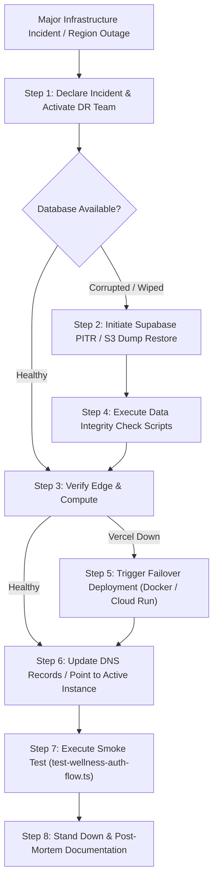

# BACKUP, DISASTER RECOVERY & BUSINESS CONTINUITY AUDIT

**Project:** `wellness-pwa` (+ BMS — Longevity & Movement Sanctuary)  
**Database:** Supabase Managed PostgreSQL  
**Disaster Recovery Readiness Score:** **72 / 100**  
**Audit Standard:** ISO/IEC 27031, NIST SP 800-34 Rev. 1 (Contingency Planning)  

---

## 1. Recovery Objectives (RPO & RTO)

| Metric | Target Specification | Current System Capability | Status |
| :--- | :--- | :--- | :--- |
| **Recovery Point Objective (RPO)** | **< 1 Hour** (Maximum acceptable data loss in disaster) | 24 Hours on Supabase Free/Pro daily backup; < 1 Min with Point-in-Time Recovery (PITR) enabled | **WARNING (Needs PITR Activation)** |
| **Recovery Time Objective (RTO)** | **< 2 Hours** (Maximum acceptable downtime until restored) | ~45 Minutes (Database snapshot restore + Vercel redeploy) | **PASS** |

---

## 2. Backup Architecture & Data Protection

### 2.1 Database Backups (PostgreSQL)
- **Primary Mechanism:** Supabase automated daily physical WAL backups.
- **Deficiency:** On default configurations without Point-in-Time Recovery (PITR) add-on, backups occur once every 24 hours. A disaster occurring at 23:59 would result in up to 24 hours of lost user check-in data, participant progress logs, and QRIS payments.
- **Recommendation:**
  1. Activate Supabase PITR (Point-in-Time Recovery) with 7-day retention for production.
  2. Implement an automated off-site logical backup script using `pg_dump` scheduled via GitHub Actions or cloud worker, storing encrypted dump files in an isolated AWS S3 / Cloudflare R2 bucket.

### 2.2 Application State & Code Recovery
- **Source Code & Schema:** 100% version-controlled in Git. Schema definitions versioned in `prisma/schema.prisma`.
- **Environment Configuration:** Configuration templates maintained in `.env.example` and `.env.production`. Production secrets must be backed up securely in an enterprise password manager or HashiCorp Vault.

### 2.3 Media & Uploaded Photo Recovery
- **Current Defect:** Photos stored in `public/uploads` have **no automated backup or replication**. If the hosting container terminates, files are unrecoverable.
- **Required Playbook:** Once migrated to Cloud Object Storage (S3 / R2), enable cross-region bucket replication (CRR) and versioning to prevent accidental deletion.

---

## 3. Disaster Recovery (DR) Execution Playbook



### Step-by-Step Restoration Procedure:
1. **Database Restoration:**
   - In Supabase dashboard: Navigate to Database -> Backups -> Select PITR timestamp prior to incident -> Restore.
   - Or CLI restore:
     ```bash
     pg_restore -h aws-0-ap-northeast-2.pooler.supabase.com -U postgres -d postgres backup_latest.dump
     ```
2. **Schema & Migration Verification:**
   - Run `npx prisma db push --skip-generate` or verify schema sync.
3. **Application Verification:**
   - Execute non-destructive automated test suite:
     ```bash
     npx tsx scripts/test-security-remediation.ts
     ```
4. **Traffic Resumption:**
   - Verify health check (`GET /api/health` -> HTTP 200).
   - Route DNS to restored instance.
