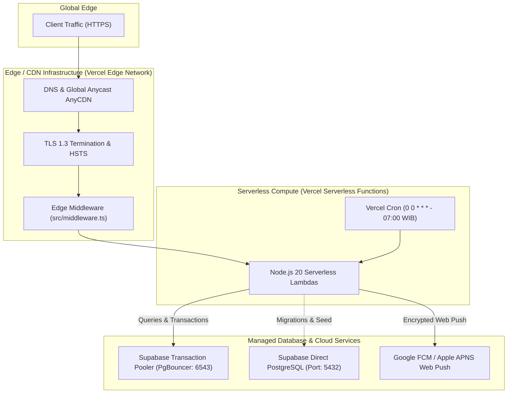

# CLOUD INFRASTRUCTURE & DEPLOYMENT AUDIT

**Project:** `wellness-pwa` (+ BMS — Longevity & Movement Sanctuary)  
**Primary Deployment Platform:** Vercel / Edge Network  
**Database Infrastructure:** Supabase Managed PostgreSQL (AWS Seoul Region: `ap-northeast-2`)  
**Infrastructure Score:** **78 / 100**  

---

## 1. Hosting Architecture & Topology



---

## 2. Infrastructure Configuration & Deployment Assets

### 2.1 Vercel Deployment Configuration (`vercel.json`)
```json
{
  "crons": [
    {
      "path": "/api/cron/dispatch-notifications",
      "schedule": "0 0 * * *"
    }
  ]
}
```
- **Evaluation:** The cron schedule `0 0 * * *` executes at `00:00 UTC`, which corresponds exactly to **`07:00 WIB` (Western Indonesia Time / UTC+7)**.
- This serves as the scheduled morning dispatch slot for cohort circadian cadence reminders.
- **Risk Identified:** Vercel Hobby tier only executes crons once daily. To dispatch midday or evening cadence reminders, the application currently relies on `/api/notifications/tick` called by active member browsers. As audited in `API-AUDIT.md`, this should be decoupled into a dedicated background worker (e.g., GitHub Actions cron or external scheduler like Upstash QStash).

### 2.2 Missing Health Check Endpoint (MEDIUM — INFRA-01)
- **Deficiency:** The application does not expose a lightweight dedicated health check endpoint (e.g. `GET /api/health` or `GET /api/ready`).
- **Impact:**
  - Automated cloud uptime monitors (UptimeRobot, BetterUptime, Datadog Synthetics) cannot probe application liveness and database connectivity without invoking full Next.js page renders.
  - Load balancers and zero-downtime deployment pipelines cannot verify pod readiness prior to routing production traffic.
- **Remediation:** Add `src/app/api/health/route.ts` that executes a lightweight query (`SELECT 1`) against Prisma and returns HTTP 200 with system uptime and version.

### 2.3 Container & Docker Support (INFORMATIONAL — INFRA-02)
- No `Dockerfile` or `docker-compose.yml` is present in the repository.
- While Vercel handles containerless deployments natively, self-hosting via Kubernetes or Docker on AWS ECS / Google Cloud Run requires a production-grade multi-stage `Dockerfile`.

---

## 3. Environment Variable & Secret Management

| Variable Name | Required Scope | Sensitivity | Current Storage | Audit Assessment |
| :--- | :--- | :--- | :--- | :--- |
| `DATABASE_URL` | Server Runtime | **HIGH (DB Password)** | `.env` / Platform Secrets | Pooler string with redacted credentials |
| `DIRECT_URL` | Server Migration | **HIGH (DB Password)** | `.env` / Platform Secrets | Direct port 5432 connection |
| `JWT_SECRET` | Server & Edge | **CRITICAL (Auth Signature)**| `.env` / Platform Secrets | Must be >= 32 characters in production |
| `CRON_SECRET` | Server Runtime | **HIGH (API Auth)** | `.env` / Platform Secrets | Used to authenticate cron invocations |
| `NEXT_PUBLIC_VAPID_PUBLIC_KEY`| Client & Server | Low (Public Key) | `.env` / Client Bundle | RFC 8292 Application Server Key |
| `VAPID_PRIVATE_KEY`| Server Runtime | **CRITICAL (Push Signature)**| `.env` / Platform Secrets | Private key for push signing |
| `VAPID_SUBJECT` | Server Runtime | Low (Contact Email) | `.env` | e.g. `mailto:support@bms.id` |
| `APP_URL` | Server Runtime | Low (Domain Origin) | `.env` | Canonical application base URL |
