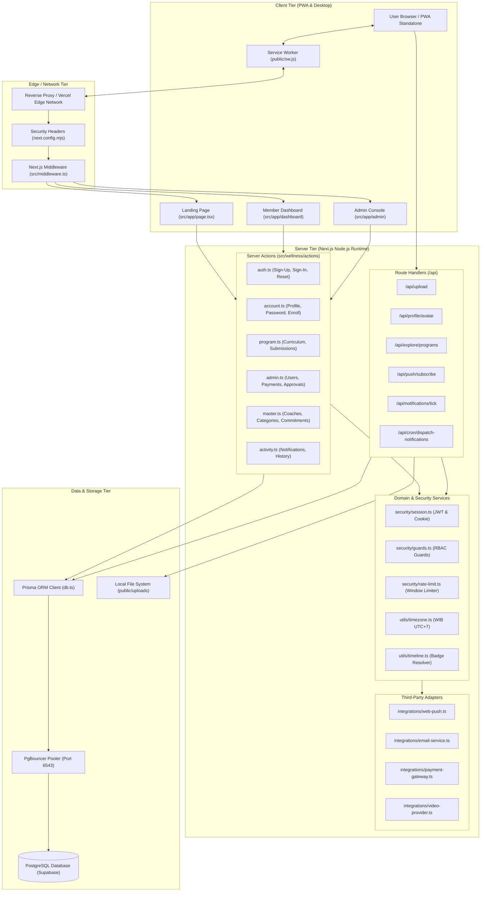
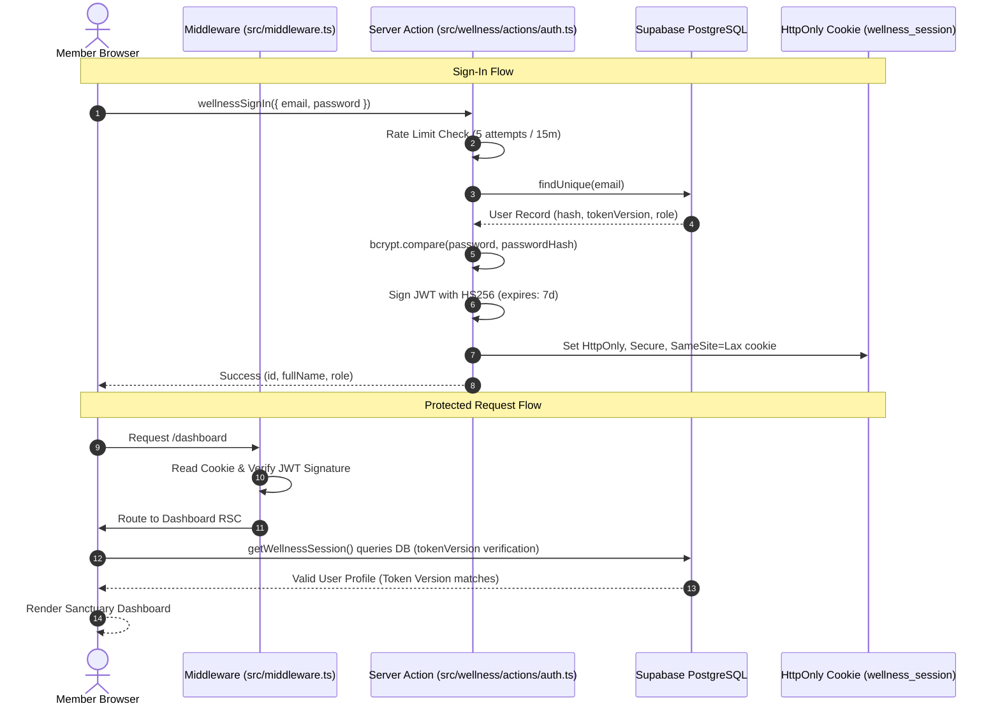

# PROJECT ARCHITECTURE & COMPONENT MAP
**Repository:** `wellness-pwa` (+ BMS — Longevity & Movement Sanctuary)  
**Framework:** Next.js 14.2 (App Router) + React 18  
**Language:** TypeScript 5.6  
**ORM & Database:** Prisma 5.19 + PostgreSQL (Supabase with PgBouncer Pooler)  
**State & Style:** Tailwind CSS 3.4, React Server Components (RSC) + Client Hooks  
**Authentication:** Jose JWT (HS256) via HttpOnly, Secure, SameSite Cookies + Database Token Versioning  

---

## 1. High-Level Architecture Diagram



---

## 2. Directory Structure & Layer Mapping

```
wellness-pwa/
├── .env, .env.example, .env.production  # Environment variables (Secrets & Configs)
├── next.config.mjs                     # Next.js bundler, rewrites, and security headers
├── package.json, package-lock.json     # Dependency manifest
├── prisma/
│   ├── schema.prisma                   # Authoritative database relational model
│   └── seed.ts                         # Initial database seeding script
├── public/                             # Public static assets & PWA manifest
│   ├── sw.js                           # Progressive Web App service worker
│   ├── manifest.json                   # Web application manifest
│   ├── icons & webp images             # Visual assets
│   └── uploads/                        # Ephemeral local storage for workouts
├── scripts/                            # Diagnostic, testing & administration scripts
│   ├── test-security-remediation.ts    # Zero-trust unit test suite
│   ├── test-wellness-auth-flow.ts      # End-to-end authentication tests
│   └── check-notification-schedule.ts  # Verification of WIB notification timing
└── src/
    ├── middleware.ts                   # Edge route protection & desktop-only guard
    ├── app/                            # Next.js App Router (pages & endpoints)
    │   ├── layout.tsx                  # Global HTML root layout, fonts & theme provider
    │   ├── page.tsx                    # Public landing page & cohort showcase
    │   ├── admin/                      # Admin Console workspace
    │   ├── dashboard/                  # PWA Member Dashboard workspace
    │   ├── reset-password/             # Password recovery token verification page
    │   └── api/                        # REST API Route Handlers
    ├── components/                     # UI Presentation components
    │   ├── admin/                      # AdminClient.tsx (Console UI)
    │   ├── auth/                       # AuthModal.tsx (Sign In / Sign Up modal)
    │   ├── checkout/                   # QrisCheckoutModal.tsx (Payment modal)
    │   ├── dashboard/                  # DashboardClient.tsx & 4 core sanctuary tabs
    │   ├── home/                       # LandingClient.tsx (Hero, Curriculum, Coaches)
    │   └── providers/                  # Theme, ServiceWorker & SmoothScroll providers
    └── wellness/                       # Core Domain, Business Logic & Integrations
        ├── db.ts                       # Singleton Prisma client instance
        ├── actions/                    # Next.js Server Actions (RPC mutations)
        ├── integrations/               # External services (Web Push, Email, QRIS, Video)
        ├── security/                   # Session, JWT, Password, Rate Limiting, Guards
        ├── utils/                      # WIB Timezone, Calendar Drip, JSON sanitizers
        └── validators/                 # Zod validation schemas
```

---

## 3. Entry Points & Routing Topology

### 3.1 Frontend User Interfaces
1. **Public Sanctuary Landing Page (`/`):**
   - File: `src/app/page.tsx` -> `src/components/home/LandingClient.tsx`
   - Purpose: Brand presentation, public cohort catalog, pricing, and guest conversion.
   - Access: Public (Guest & Authenticated).

2. **Member Sanctuary Dashboard (`/dashboard`):**
   - File: `src/app/dashboard/page.tsx` -> `src/components/dashboard/DashboardClient.tsx`
   - Purpose: 4-Tab sanctuary interface (My Plan, Daily Check-In, Explore Programs, Profile).
   - Access: Authenticated users (`role: "USER" | "SUPERADMIN"`, `status: "ACTIVE"`).

3. **Admin Operational Console (`/admin`):**
   - File: `src/app/admin/(dashboard)/[[...slug]]/page.tsx` -> `src/components/admin/AdminClient.tsx`
   - Purpose: Program curriculum authoring, cohort scheduling, quota management, payment approvals, participant tracking, and master taxonomy directories.
   - Access: Restricted to authenticated `SUPERADMIN` sessions on desktop viewport (mobile redirected to `/admin/desktop-required`).

4. **Desktop Guard Fallback (`/admin/desktop-required`):**
   - File: `src/app/admin/desktop-required/page.tsx`
   - Purpose: Informative screen shown when mobile browsers attempt to access the Admin Console.

5. **Password Reset Flow (`/reset-password`):**
   - File: `src/app/reset-password/page.tsx`
   - Purpose: Verifies single-use 256-bit crypto tokens and sets new account password.

### 3.2 Backend API Route Handlers (`/api/*`)
| Route | Method | Access Level | Purpose |
| :--- | :--- | :--- | :--- |
| `/api/upload` | `POST` | Authenticated | Validates image magic bytes and saves workout photos |
| `/api/profile/avatar` | `POST`, `DELETE` | Authenticated | Validates and stores compressed profile picture |
| `/api/explore/programs` | `GET` | Authenticated | Retrieves published cohort catalog with filters & sorting |
| `/api/push/subscribe` | `GET`, `POST`, `DELETE` | Authenticated | Manages Web Push VAPID push subscriptions (SSRF protected) |
| `/api/notifications/tick` | `POST` | Authenticated | Heartbeat notification trigger called by active member sessions |
| `/api/cron/dispatch-notifications`| `GET`, `POST` | `CRON_SECRET` | Server-side scheduled cron dispatcher for due cohort notifications |

---

## 4. Database Schema & Relational Design

The database is structured in **Third Normal Form (3NF)** with strict referential constraints:
- **`users`:** Core identities, password hashes, `tokenVersion` session revocation, roles (`USER`, `SUPERADMIN`), statuses (`ACTIVE`, `SUSPENDED`).
- **`password_reset_tokens`:** Ephemeral single-use 256-bit tokens linked `1:N` to `users` with `onDelete: Cascade`.
- **`programs`:** Cohort programs, titles, slugs, prices, quotas, start/end dates, WIB registration deadlines.
- **`program_days`:** Sequential curriculum days (1..N), day types (`TRAINING_DAY`, `REST_DAY`, `CONNECTION_DAY`, `MEETUP_DAY`), video links, tasks, checklists. Unique constraint on `[programId, dayNumber]`.
- **`program_enrollments`:** Junction between `users` and `programs` tracking payment references, QRIS validity windows (15-min countdown), attendance modes (`VIRTUAL`, `IN_PERSON`), and legal terms agreement timestamps.
- **`program_day_progress`:** User progress records for each curriculum day (checklists, video watch status, sleep metrics, meal compliance, photos). Unique on `[userId, programDayId]`.
- **`master_*`:** Isolated catalog tables (`MasterCoach`, `MasterCategory`, `MasterTargetAudience`, `MasterEquipment`, `MasterDailyCommitment`).
- **`program_*` (Pivots):** Relational junctions (`ProgramCoach`, `ProgramCategory`, `ProgramAudience`, `ProgramEquipment`) enforcing `Restrict` on deletion of active master items and `Cascade` when programs are deleted.
- **`push_subscriptions`:** W3C Web Push endpoints, p256dh and auth keys per user.
- **`user_notifications`:** In-app inbox messages with deduplication keys (`dedupeKey`) preventing duplicate dispatch.
- **`customer_health_profiles`:** Baseline health metrics, body measurements, dietary preferences, and front/side/back baseline photos.

---

## 5. Security & Authentication Model


