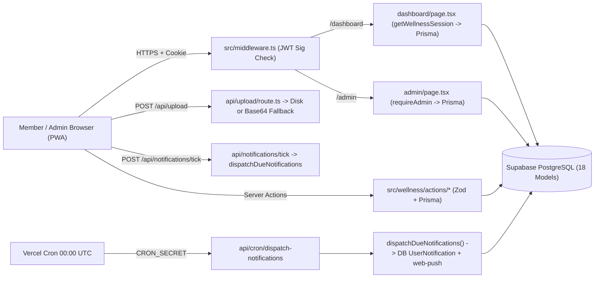

# PROJECT ARCHITECTURE MAP

## 1. Technology Stack & Runtime
- **Framework**: Next.js `14.2.35` (App Router, React `18.3.1`, TypeScript strict mode)
- **Database ORM**: Prisma Client (`5.22.0` generated, `^5.19.0` CLI) targeting **PostgreSQL** (`prisma/schema.prisma`, dual `DATABASE_URL` pooler + `DIRECT_URL`)
- **Authentication**: Custom HS256 JWT (`jose`) stored in `httpOnly` cookie (`wellness_session`), passwords hashed via `bcryptjs` (12 salt rounds), session revocation via `User.tokenVersion` + `User.status`
- **Validation**: `zod` schemas in `src/wellness/validators/`
- **Styling & UI**: Tailwind CSS v3 + `lucide-react` + `lenis` smooth scrolling
- **PWA / Notifications**: Custom Service Worker (`public/sw.js` v8), Web Manifest (`public/manifest.json`), VAPID `web-push` (`src/wellness/integrations/web-push.ts`)
- **Deployment Target**: Vercel (`vercel.json` cron + Serverless Next.js routes/actions)

---

## 2. Entry Points

| Layer | Entry File | Auth / Access Control | Purpose |
|---|---|---|---|
| **Edge Middleware** | [src/middleware.ts](file:///c:/Users/Steven/.gemini/antigravity/scratch/wellness-pwa/src/middleware.ts) | Verifies `wellness_session` JWT signature & expiry on `/admin/*` & `/dashboard/*`; redirects mobile `/admin` UAs unless `?forceDesktop=true` | Fast edge gating + device routing |
| **Root / Landing** | [src/app/page.tsx](file:///c:/Users/Steven/.gemini/antigravity/scratch/wellness-pwa/src/app/page.tsx) | Public | Landing page + public featured programs catalog |
| **Password Reset** | [src/app/reset-password/page.tsx](file:///c:/Users/Steven/.gemini/antigravity/scratch/wellness-pwa/src/app/reset-password/page.tsx) | Token-based | Consumes SHA-256 hashed single-use reset token |
| **Member App** | [src/app/dashboard/page.tsx](file:///c:/Users/Steven/.gemini/antigravity/scratch/wellness-pwa/src/app/dashboard/page.tsx) | Server-checked `getWellnessSession()` (`ACTIVE` + `tokenVersion`) | Member tabs: Today, My Plan, Explore, Notifications, Profile |
| **Admin Portal** | [src/app/admin/(dashboard)/[[...slug]]/page.tsx](file:///c:/Users/Steven/.gemini/antigravity/scratch/wellness-pwa/src/app/admin/%28dashboard%29/%5B%5B...slug%5D%5D/page.tsx) | `requireAdmin()` (`ADMIN` role + `ACTIVE` + `tokenVersion`) | Programs, Days, Customers, Master Data, Audit Overview |
| **API Routes** | `src/app/api/**` (6 routes) | Mixed (`CRON_SECRET`, session, or public explore) | Cron, tick polling, upload, avatar, explore, web push |
| **Server Actions** | `src/wellness/actions/**` (6 files) | `requireAuth()` / `requireAdmin()` / public auth | Auth, enrollment, checkout, daily check-in, admin CRUD |
| **Service Worker** | [public/sw.js](file:///c:/Users/Steven/.gemini/antigravity/scratch/wellness-pwa/public/sw.js) | Browser SW scope `/` | 60ms instant shell, offline fallback, static cache, push events |

---

## 3. Component & Data Flow Diagram

---

## 4. Background Jobs, Schedulers & Event Listeners
- **Vercel Cron (`vercel.json`)**: `GET /api/cron/dispatch-notifications` at `0 0 * * *` (00:00 UTC / 07:00 WIB). Requires `Authorization: Bearer <CRON_SECRET>` or `?secret=...`.
- **Client Polling (`DashboardClient.tsx`)**: Interval calls `POST /api/notifications/tick` (rate-limited 4 req/min/user) to trigger `dispatchDueNotifications({ lookbackMinutes: 2 })` intraday.
- **Browser Events (`public/sw.js`)**: `install`, `activate`, `fetch`, `push`, `notificationclick`.
- **Queues / Message Brokers / Webhooks**: **None implemented** (no BullMQ, SQS, Inngest, or payment webhook endpoint exists).
