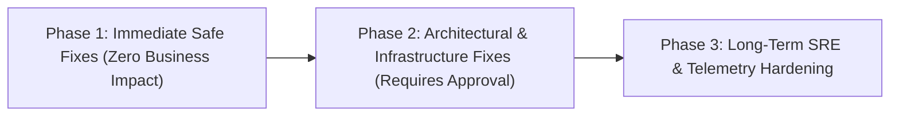

# PRODUCTION REMEDIATION PLAN & IMPLEMENTATION ROADMAP

**Project:** `wellness-pwa` (+ BMS — Longevity & Movement Sanctuary)  
**Strategy Standard:** Defense-in-Depth, Zero-Omission Quality Engineering, Controlled Phased Delivery  

---

## 1. Remediation Phase Matrix

| Phase | Target Scope | Risk Level | Downtime | Production Approval Required? |
| :--- | :--- | :--- | :--- | :--- |
| **Phase 1** | Security headers, JWT validation hardening, VAPID key cleanup, PWA manifest scope, sharp dependency, .gitignore | **LOW** | 0 min | **Pre-Approved (Safe Non-Breaking Fixes)** |
| **Phase 2** | Cloud object storage (S3/R2), Service worker navigation rewrite, Redis rate limiting, PgBouncer pooler limit | **MEDIUM** | 0 min | **YES (Database / Storage / Cloud Infrastructure)** |
| **Phase 3** | Sentry APM, GitHub Actions CI, AdminClient component modularization, Vitest test suite | **LOW** | 0 min | No (Developer Experience & Monitoring) |

---

## 2. Phase 1: Immediate Safe Fixes (Implementation Plan)

### Step 1.1: Enforce Strict JWT_SECRET Verification (SEC-01)
- **Target:** `src/middleware.ts`, `src/wellness/security/session.ts`
- **Action:** If `process.env.JWT_SECRET` is unset in production (`NODE_ENV === "production"`), fail closed by throwing an unrecoverable configuration error instead of defaulting to the static dev secret.

### Step 1.2: Remove Hardcoded VAPID Private Key (SEC-02)
- **Target:** `src/wellness/integrations/web-push.ts`
- **Action:** Remove the static fallback private key literal. Require `process.env.VAPID_PRIVATE_KEY` and emit a warning in development if missing.

### Step 1.3: Configure Production Security Headers (SEC-03)
- **Target:** `next.config.mjs`
- **Action:** Add `Strict-Transport-Security` (HSTS), `Content-Security-Policy` (CSP), `Cross-Origin-Opener-Policy` (COOP), and update `Permissions-Policy` to permit camera for self (needed for workout check-in photos).

### Step 1.4: Disallow Secret via URL Query in Cron Route (SEC-05)
- **Target:** `src/app/api/cron/dispatch-notifications/route.ts`
- **Action:** In production mode, strictly require `Authorization: Bearer <CRON_SECRET>`. Reject query parameter tokens (`?secret=...`).

### Step 1.5: Fix PWA Manifest Scope (PWA-02)
- **Target:** `public/manifest.json`
- **Action:** Add `"scope": "/"` to guarantee standalone PWA navigation stays within the PWA window.

### Step 1.6: Promote `sharp` to Runtime Dependencies (OPS-02)
- **Target:** `package.json`
- **Action:** Move `"sharp": "^0.35.5"` from `devDependencies` to `dependencies`.

### Step 1.7: Update `.gitignore` for Obsolete SQLite Databases (CODE-01)
- **Target:** `.gitignore`
- **Action:** Add `/prisma/*.db` to prevent tracking legacy local SQLite databases.

---

## 3. Phase 2: Infrastructure & Architectural Remediations (Requires Approval)

### 2.1 Cloud Object Storage Migration (STOR-01)
- **Problem:** Serverless lambdas cannot write to `public/uploads/` and fall back to storing 5MB base64 data URLs in PostgreSQL text columns.
- **Proposed Architecture:**
  1. Provision a private Supabase Storage Bucket or Cloudflare R2 / AWS S3 bucket `bms-sanctuary-media`.
  2. Implement an authenticated signed upload URL endpoint (`POST /api/upload/sign`).
  3. Client uploads directly to the object store; only the resulting HTTPS CDN URL is stored in `ProgramDayProgress`.

### 2.2 Service Worker Navigation Stabilization (PWA-01)
- **Problem:** The 60ms timeout race condition in `public/sw.js` risks infinite reload loops on high-latency mobile networks.
- **Proposed Architecture:**
  1. Replace the in-memory synthetic 60ms navigation intercept with a reliable Network-First strategy with fallback to `public/offline.html`.
  2. Enable browser Navigation Preload (`registration.navigationPreload.enable()`) to optimize mobile TTFB without synthetic screen replaces.

### 2.3 Distributed Rate Limiting via Redis (SEC-04)
- **Problem:** In-memory `Map` rate limiting is bypassed across serverless lambda containers.
- **Proposed Architecture:**
  1. Connect Upstash Redis (serverless REST-based Redis).
  2. Use `@upstash/ratelimit` with a sliding window algorithm across all authentication endpoints.

### 2.4 Supabase PgBouncer Pooler Concurrency Limit (OPS-01)
- **Problem:** `connection_limit=1` causes connection starvation during concurrent checkouts.
- **Proposed Architecture:**
  1. Update `.env.production` / Supabase pooler connection string to set `connection_limit=10`.
  2. Ensure interactive transactions release connections immediately upon completion.

---

## 4. Phase 3: Post-Launch & Long-Term Reliability

1. **APM & Sentry Integration:** Install `@sentry/nextjs` for distributed tracing and real-time crash alerting.
2. **Modularize Admin Console:** Split `AdminClient.tsx` (11,719 lines) into 5 focused sub-tab components using `next/dynamic`.
3. **CI/CD Pipeline:** Configure `.github/workflows/ci.yml` running linting, typechecks, Vitest unit tests, and security scans on every pull request.
